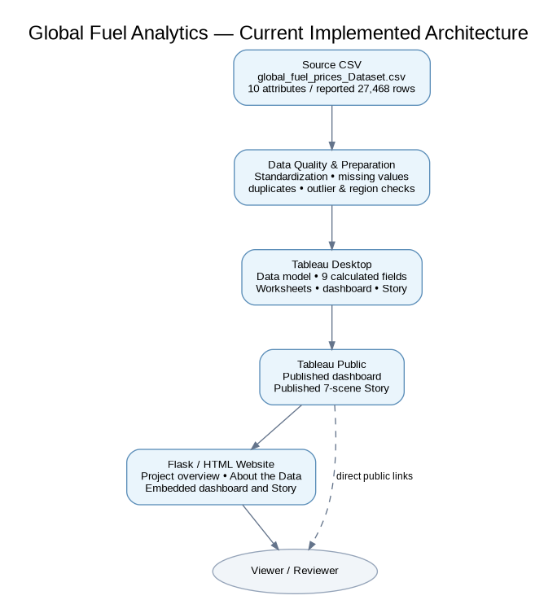

# Project Design

## Problem–solution fit
| User problem | Solution feature | Evidence |
|---|---|---|
| Manual comparison of many records is slow | KPI cards, maps, lines and ranked comparisons | Published Tableau dashboard |
| Geographic and time differences are hard to detect | Country maps and time-series views | Dashboard workbook contains petrol, diesel, LPG and Brent crude charts |
| Users want to focus the analysis | Date, Region, Income Level and Subsidy Level filters | All four were tested by the owner and updated relevant charts |
| Findings need narrative order | Seven-scene Tableau Story | Owner confirmed all seven scenes navigable |

## Proposed solution
Connect the CSV to Tableau, inspect and prepare data, create nine calculated fields and diagnostic worksheets, build the visualizations/dashboard/Story, publish to Tableau Public, and link/embed the views in the project website.

## Current architecture
The current implementation is a CSV-driven Tableau workflow with a web presentation layer. The workbook points to a local Windows path: `C:/Users/Rudra/Downloads/global_fuel_prices_Dataset.csv`; another machine may need the source path relinked. Data updates must be refreshed and republished where applicable.

The confirmed workbook does not evidence a separate database, Snowflake warehouse or SQL pipeline.

## Scope boundary
The work is descriptive and comparative. It does not establish that taxation or subsidies caused an observed fuel-price difference, and it does not include a predictive model.
