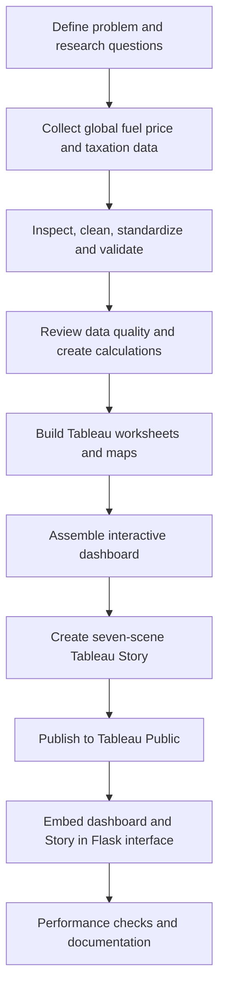

<div align="center">


# 🌍 Global Fuel Prices & Taxation Trends

### A Comprehensive Global Performance Intelligence Report

<p>
  
  
  
  
</p>

**Exploring how fuel prices and taxation patterns vary across countries, regions, and time.**

[📊 Open Interactive Dashboard](https://public.tableau.com/app/profile/rudraraj.singh/viz/Global_Fuel_Prices_and_Taxation_Trends/GlobalFuelPricesandTaxationTrendsfinal) · [📖 Explore the Tableau Story](https://public.tableau.com/app/profile/rudraraj.singh/viz/Global_Fuel_Prices_and_Taxation_Trends/Story1)

</div>

---

## ✨ Project at a glance

| Dataset metric | Project-reported value |
|---|---:|
| Records | **27,468** |
| Attributes | **10** |
| Countries | **84** |
| Global regions | **7** |
| Reported data period | **January 2020 – April 2026** |
| Reported dataset size | **~2.7 MB** |
| Tableau calculated fields identified | **9** |
| Filters tested successfully | **4** |

> These dataset figures are the values recorded during project work. Browser performance figures below are from one observed test session and may vary with network and device conditions.

## 🎯 Problem statement

Fuel prices influence transportation, production costs, household spending, and the wider economy. Yet prices and tax levels differ substantially across countries, with patterns influenced by policy, regional conditions, economic circumstances, and subsidy approaches.

This project organizes global fuel-price and taxation data into interactive Tableau views so viewers can compare countries and regions, explore movements through time, and inspect patterns across income and subsidy categories. The analysis describes observed differences and associations; it does not by itself establish that a particular tax or subsidy caused a price movement.

## 🗺️ Visual journey: from geography to trends

<div align="center">
  
  <sub>The animation is decorative and illustrative; use the linked Tableau dashboard for the project's actual values.</sub>
</div>

The project combines several analytical perspectives:

- **Geographic comparison:** maps help explore petrol and diesel prices across countries.
- **Time-series analysis:** trend views compare movements in petrol, diesel, LPG, and crude-oil indicators over time.
- **Taxation analysis:** regional comparisons show differences in average tax percentage.
- **Country comparison:** comparative charts highlight differences between selected countries.
- **Economic context:** income-level and subsidy categories help organize comparisons.

## 🔎 Data and preprocessing

The working dataset was reported as containing 27,468 records and 10 attributes, with weekly observations covering January 2020 through April 2026 across 84 countries and seven regions.

Preprocessing and quality checks recorded during the project included:

1. Reviewing missing-value status.
2. Checking for duplicate country-date records.
3. Reviewing fuel-price and tax-rate outliers.
4. Standardizing formats and categorical values.
5. Checking country-to-region mappings.
6. Arranging records chronologically.
7. Reviewing calculated fields used for data-quality checks and analytical comparisons.

The project notes reported no missing values. The checks and diagnostic worksheets are part of the Tableau workbook; conclusions should be interpreted within the dataset's available coverage and definitions.

## 📊 Explore the published Tableau work

### Interactive dashboard

The dashboard brings together KPI-style indicators, global geographic comparisons, time-series charts, taxation summaries, and country-level comparisons. It supports filtering by **Date, Region, Income Level, and Subsidy Level**, which were tested successfully during project performance testing.

<div align="center">

[**Launch dashboard on Tableau Public ↗**](https://public.tableau.com/app/profile/rudraraj.singh/viz/Global_Fuel_Prices_and_Taxation_Trends/GlobalFuelPricesandTaxationTrendsfinal)

</div>

### Seven-scene Tableau Story

The Story presents the analysis in a guided sequence:

1. Introduction — problem statement and research question
2. Geographic disparity — global price variation
3. Temporal trends — price movement over time
4. Taxation policy — regional tax comparison
5. Economic impact — income-level comparison
6. Subsidy assessment — government-support categories
7. Conclusions and recommendations

<div align="center">

[**Open the seven-scene Story on Tableau Public ↗**](https://public.tableau.com/app/profile/rudraraj.singh/viz/Global_Fuel_Prices_and_Taxation_Trends/Story1)

</div>

## 💡 Key insights highlighted by the analysis

- **Regional variation:** average fuel prices and tax percentages differ across regions.
- **Time matters:** trend charts make changes and convergence/divergence patterns easier to inspect.
- **Policy context:** taxation and subsidy categories provide useful dimensions for comparing countries.
- **No single-cause conclusion:** the visuals reveal patterns in the dataset, not causal proof of policy effects.

For exact figures and filter-dependent results, refer to the published dashboard rather than treating the README's summary as a substitute for the interactive analysis.

## 🧪 Performance testing

The published dashboard was tested in a browser in one observed session:

| Check | Observed result |
|---|---|
| Initial dashboard load | **5 seconds** |
| Single-filter update | **4 seconds** |
| Two-filter update | **5 seconds** |
| Visualizations visible after load | **Yes** |
| Blank charts/errors observed | **None** |
| Date filter | Passed |
| Region filter | Passed |
| Income Level filter | Passed |
| Subsidy Level filter | Passed |
| Country and Measure/Fuel Type controls | Not visible during the test |

These are single-session observations, not guaranteed service-level performance metrics.

## 🧱 Project workflow



## 🖥️ Web integration

A Flask interface was developed to present the Global Fuel Analytics project and provide access to the Tableau dashboard and Story. The Tableau visualizations remain hosted on Tableau Public and need an internet connection when embedded.

The expected local launch command for the Flask project is:

```bash
py app.py
```

Open `http://127.0.0.1:5000/` after the local Flask server starts. This local command applies only if the Flask files and dependencies are present in the project folder; the public Tableau links work independently of the Flask application.

## 📁 Repository guide

The repository is organized around the project phases and their supporting documentation:

| Folder | Purpose |
|---|---|
| [`IdeationPhase/`](IdeationPhase/README.md) | Initial problem framing and ideation |
| [`Requirement Analysis/`](Requirement%20Analysis/README.md) | Requirements and analysis |
| [`Project Design/`](Project%20Design/README.md) | Solution concept and architecture |
| [`Project Planning/`](Project%20Planning/README.md) | Project phases and planning |
| [`Project Development/`](Project%20Development/README.md) | Tableau dashboard, Story, and visualization work |
| [`Performance Testing/`](Performance%20Testing/README.md) | Performance and filter checks |
| [`Project Documentation/`](Project%20Documentation/README.md) | Final report and project records |
| [`Project Demonstration/`](Project%20Demonstration/README.md) | Demo plan and recording materials |

## 🧰 Tools and technologies

- **Tableau Desktop / Tableau Public** — data visualization, dashboard, Story, and publication.
- **CSV dataset** — source data used for the analysis.
- **Flask** — web interface for presenting the project and embedded Tableau views.
- **HTML, CSS, JavaScript** — interface structure, styling, and embedding support.
- **GitHub** — source control and phase-based project documentation.

## ▶️ How to explore

1. Open the [published dashboard](https://public.tableau.com/app/profile/rudraraj.singh/viz/Global_Fuel_Prices_and_Taxation_Trends/GlobalFuelPricesandTaxationTrendsfinal).
2. Try the Date, Region, Income Level, and Subsidy Level filters.
3. Open the [seven-scene Story](https://public.tableau.com/app/profile/rudraraj.singh/viz/Global_Fuel_Prices_and_Taxation_Trends/Story1) and navigate from introduction to conclusions.
4. Browse the phase folders above for project documentation and process notes.

## 🚧 Limitations and future improvements

- Recheck date-axis labels against the reported data ending in April 2026; some workbook chart titles have previously displayed 2027.
- Make Country and Measure/Fuel Type controls visibly available if they are required features.
- Record performance over repeated runs and different network conditions for stronger benchmarking.
- Add the final recorded project demonstration video after it is produced.
- Add the exact source download URL and dataset license/attribution details when confirmed.

## 📹 Project demonstration

**Video:** Add the 5–7 minute screen-share recording link here after uploading the final video to your chosen hosting location or repository release.

## 👤 Project information

**Project:** Global Fuel Prices and Taxation Trends: A Comprehensive Global Performance Intelligence Report  
**Author:** Rudraraj Singh Bhati  
**Repository:** [Tableau_viz on GitHub](https://github.com/rudrarajsingh887/Tableau_viz)

---

<div align="center">

**Turning global fuel data into clearer comparisons, trends, and policy questions.**

<sub>Built as an academic data-visualization project using Tableau, with a Flask web interface for presentation.</sub>

</div>
